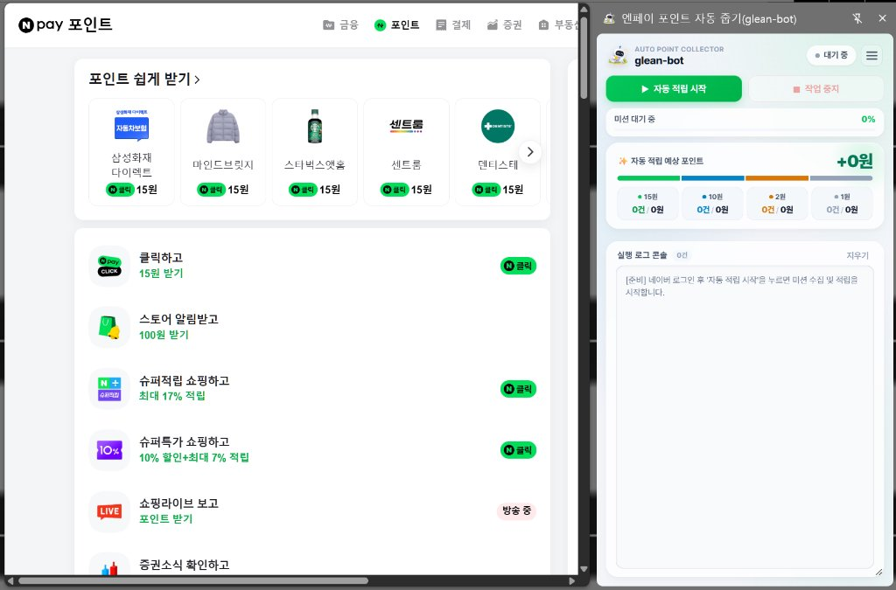

#  네줍기 (엔페이 포인트 자동 줍기)

> **Chrome Web Store Manifest V3 Extension**  
> 네이버페이 혜택 미션(15원/10원/5원/2원/1원/쇼핑라이브)을 브라우저 사이드 패널(Side Panel)에서 실시간으로 관제하며 안전하게 자동 적립하고 실제 적립 내역까지 검증하는 확장 프로그램입니다.

---

## 📌 주요 링크 (Official Links)
- **공식 소개 페이지**: [https://leejhn.github.io/glean-bot/](https://leejhn.github.io/glean-bot/)
- **개인정보처리방침 (Privacy Policy)**: [https://leejhn.github.io/glean-bot/privacy.html](https://leejhn.github.io/glean-bot/privacy.html)
- **자주 묻는 질문 (FAQ)**: [https://leejhn.github.io/glean-bot/support.html](https://leejhn.github.io/glean-bot/support.html)

---

## 🌟 핵심 기능 (Key Features)

1. **지능형 미션·추가 링크 수집 및 커뮤니티 실시간 필터링**
   - 15원, 10원, 5원, 2원, 1원 미션 및 쇼핑/보험 추가 링크를 통합 수집해 순차 큐 구성
   - 이미 참여한 미션과 커뮤니티 히든 미션·만료된 링크 실시간 필터링

2. **쇼핑라이브 무음 적립 & 사람다운 안전 체류**
   - 쇼핑라이브 탭 자동 음소거 적립 및 제휴 광고망(`adcr`, `pincrux`) 리다이렉트 감지
   - 불규칙 랜덤 딜레이(2~4초) 및 체류형 미션/추가 혜택 페이지 3~5초 이상 안전 체류

3. **상시 고정 사이드 패널, 실제 적립 검증 & 라이트/블랙 테마**
   - 브라우저 우측에 상시 고정되어 실시간 진행률(Progress Bar), 분할 게이지, 터미널 로그 출력
   - 작업 완료 시 네이버페이 포인트 내역 자동 대조로 실제 적립 포인트 검증 및 라이트/블랙 테마 지원

4. **매일 지정 시각 예약 실행 & 예정 쇼핑라이브(+10분) 자동 예약**
   - 원하는 시각(예: `09:00`) 설정 시 브라우저 실행 중 매일 정해진 시각에 자동 수행
   - 예정된 쇼핑라이브 방송 감지 시 시작 10분 후 1회성 라이브 적립 자동 예약 및 완료 알림음 재생

---

## 🔒 개인정보 보호 원칙 (Privacy & Security)

- **개인정보 비수집 · 로컬 세션 실행**: 계정·쿠키·결제 정보 등 개인정보는 일절 수집·전송하지 않으며 로컬 브라우저 세션과 `chrome.storage.local`을 기반으로 동작합니다. 최신 공개 미션 정보 및 서비스 안정성 유지를 위해 최소한의 비식별 통신만 사용합니다.
- **계정 정보 비수집**: 사용자의 아이디, 비밀번호, 결제 정보 등을 일절 입력받지 않으며 브라우저에 이미 로그인된 정상 네이버 세션을 활용합니다.
- **로컬 격리 저장**: 설정값(딜레이, 1원 제외, 추가 링크, 예정 라이브 자동 예약 등)과 통계 데이터는 브라우저 내부 스토리지(`chrome.storage.local`)에만 안전하게 저장됩니다.

---

## 📋 크롬 웹스토어 권한 소명서 (Permission Justifications for Reviewers)

Google Chrome Web Store 보안 및 단일 목적(Single Purpose) 심사 기준에 맞춘 각 권한의 사용 목적입니다:

| 권한 (Permission) | 소명 사유 (English Justification) | 국문 사용 사유 |
| :--- | :--- | :--- |
| `sidePanel` | Used to render a persistent control and live monitoring dashboard that does not close on blur. | 브라우징을 방해하지 않고 상시 모니터링 가능한 컨트롤 패널 UI 제공 |
| `storage` | Used locally to persist user configuration, scheduler settings, and daily accumulation stats. | 사용자 설정(딜레이, 예약 시각 등) 및 일일 적립 통계 로컬 저장 |
| `tabs` | Used to open mission URLs, monitor load completion, and close tabs upon earning points. | 미션 대상 탭 열기, 로딩 상태 감지 및 적립 완료 후 탭 자동 종료 |
| `scripting` | Used to interact with point claim buttons and detect popup overlays on benefit pages. | 미션 상세 페이지 내 포인트 받기 버튼 클릭 및 안내 팝업 감지 |
| `offscreen` | Used exclusively to play a completion chime (HTML5 Audio) in background under Manifest V3. | Manifest V3 규격에 따라 미션 완료 알림음(오디오) 백그라운드 재생 |
| `alarms` | Used to schedule daily runs and one-shot upcoming Shopping Live runs (+10m) at scheduled times. | 매일 지정 시각 및 예정 쇼핑라이브(+10분) 1회성 자동 실행 스케줄링 |
| `cookies` | Used solely to verify if the user's active Naver login session (`NID_AUT`, `NID_SES`) is valid. | 네이버 로그인 유지 여부를 확인하여 로그인 필요 상태 안내 |
| `host_permissions` (`point.pay.naver.com`, `*.pay.naver.com`, `nid.naver.com`, `*.naver.com`, `*.adison.co`, `nsl.pincrux.com`) | Required to collect benefit missions, detect affiliate ad/Shopping Live redirects (`adison`/`pincrux`), and verify Naver login status. | 네이버페이 혜택·미션 수집, 제휴 광고/쇼핑라이브 도달 감지 및 네이버 로그인 상태 확인 |

---

## 💻 사용 방법 (Quick Start)

1. 크롬 브라우저 툴바에서 **네줍기 (엔페이 포인트 자동 줍기)** 아이콘을 클릭하여 사이드 패널을 엽니다.
2. 네이버에 로그인한 후, 사이드 패널에서 **[▶ 자동 적립 시작]** 버튼을 클릭합니다.
3. 매일 같은 시각에 자동으로 실행되길 원하시면 **'매일 정해진 시각 시작'**을 켜고 원하는 시간을 설정해 두시면 됩니다.

