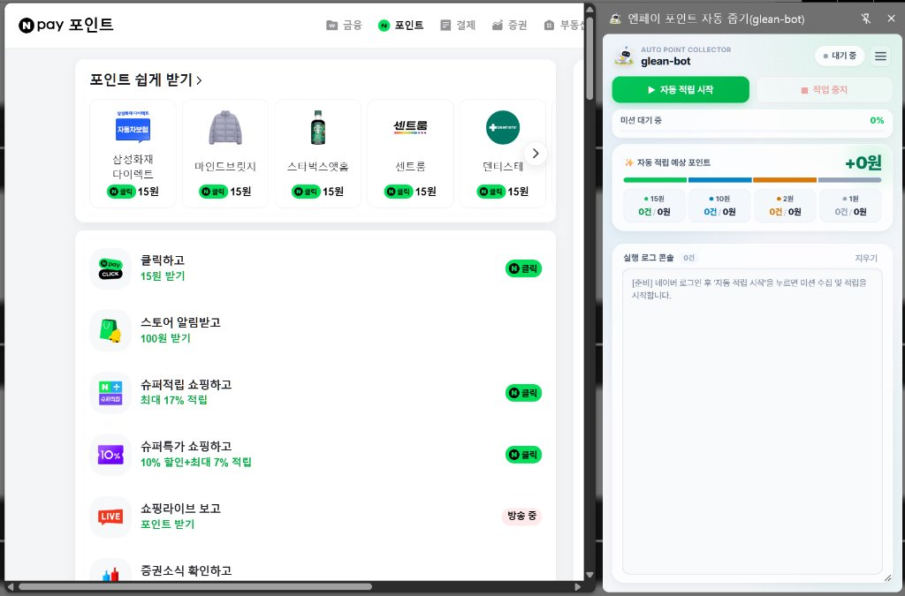

#  엔페이 포인트 자동 줍기(glean-bot)

> **Chrome Web Store Manifest V3 Extension**  
> 네이버페이 혜택 미션을 브라우저 사이드 패널(Side Panel)에서 실시간으로 관제하며 안전하게 자동 적립하는 확장 프로그램입니다.

---

## 📌 주요 링크 (Official Links)
- **공식 소개 페이지**: [https://leejhn.github.io/glean-bot/](https://leejhn.github.io/glean-bot/)
- **개인정보처리방침 (Privacy Policy)**: [https://leejhn.github.io/glean-bot/privacy.html](https://leejhn.github.io/glean-bot/privacy.html)
- **자주 묻는 질문 (FAQ)**: [https://leejhn.github.io/glean-bot/support.html](https://leejhn.github.io/glean-bot/support.html)

---

## 🌟 핵심 기능 (Key Features)

1. **지능형 미션 소스(DOM) 분석 및 중복 제거**
   - 15원, 10원, 2원, 1원 미션을 카테고리별로 자동 분류하여 순차 큐 구성
   - 이미 완료된 미션(`type_has_points`) 및 불필요한 Alert 유발 링크 자동 필터링

2. **사람다운 안전 체류 시뮬레이션**
   - 미션 유형별 정밀 타이머 및 불규칙 랜덤 딜레이(2~4초) 적용으로 안정적인 적립 보장
   - 1원 미션의 경우 제휴 광고망 리다이렉트 후 최종 스토어 도달 시 3초 이상 안전 체류

3. **브라우저 우측 상시 고정 사이드 패널 (Side Panel)**
   - 팝업창과 달리 브라우저 화면 어디를 클릭해도 닫히지 않고 우측에 상시 고정
   - 실시간 진행률(Progress Bar), 금액별 완료 통계, 터미널 로그 실시간 출력

4. **매일 지정 시각 무인 예약 실행**
   - 원하는 시간(예: `09:00`)을 설정해두면 브라우저 실행 중 매일 정해진 시각에 자동 수행
   - 작업 완료 시 맑은 3단 화음(비프음) 자동 재생

---

## 🔒 개인정보 보호 원칙 (Privacy & Security)

- **100% Client-Only 로컬 아키텍처**: 개발자 서버나 제3자 서버로 어떠한 개인 데이터도 수집·전송·보관하지 않습니다.
- **계정 정보 비수집**: 사용자의 아이디, 비밀번호, 결제 정보 등을 일절 입력받지 않으며 브라우저에 이미 로그인된 정상 네이버 세션을 활용합니다.
- **로컬 격리 저장**: 설정값(딜레이, 1원 제외 여부 등)과 통계 데이터는 브라우저 내부 스토리지(`chrome.storage.local`)에만 안전하게 저장됩니다.

---

## 📋 크롬 웹스토어 권한 소명서 (Permission Justifications for Reviewers)

Google Chrome Web Store 보안 및 단일 목적(Single Purpose) 심사 기준에 맞춘 각 권한의 사용 목적입니다:

| 권한 (Permission) | 소명 사유 (English Justification) | 국문 사용 사유 |
| :--- | :--- | :--- |
| `sidePanel` | Used to render a persistent control and live monitoring dashboard that does not close on blur. | 브라우징을 방해하지 않고 상시 모니터링 가능한 컨트롤 패널 UI 제공 |
| `storage` | Used locally to persist user configuration, scheduler settings, and daily accumulation stats. | 사용자 설정(딜레이, 예약 시각 등) 및 일일 적립 통계 로컬 저장 |
| `tabs` | Used to open mission URLs, monitor load completion, and close tabs upon earning points. | 미션 대상 탭 열기, 로딩 상태 감지 및 적립 완료 후 탭 자동 종료 |
| `scripting` | Used to interact with point claim buttons and detect popup overlays on benefit pages. | 미션 상세 페이지 내 포인트 받기 버튼 클릭 및 안내 팝업 감지 |
| `offscreen` | Used exclusively to play a completion chime (HTML5 Audio) in background under Manifest V3. | Manifest V3 규격에 따라 미션 완료 알림음(오디오) 백그라운드 재생 |
| `alarms` | Used to schedule recurring daily automated runs at the user-specified time. | 사용자가 지정한 매일 특정 시각 자동 실행 스케줄러 기능 |
| `cookies` | Used solely to verify if the user's active Naver login session (`NID_AUT`, `NID_SES`) is valid. | 네이버 로그인 유지 여부를 확인하여 로그인 필요 상태 안내 |
| `host_permissions` & `<all_urls>` | Required because 1-won missions redirect through external ad tracking domains and sponsor web stores before earning points. | 1원 미션 수행 시 제휴 광고망 및 외부 쇼핑몰 도달 감지 및 안전 체류 처리 |

---

## 💻 사용 방법 (Quick Start)

1. 크롬 브라우저 툴바에서 **glean-bot** 아이콘을 클릭하여 사이드 패널을 엽니다.
2. 네이버에 로그인한 후, 사이드 패널에서 **[▶ 자동 적립 시작]** 버튼을 클릭합니다.
3. 매일 같은 시각에 자동으로 실행되길 원하시면 **'⏰ 매일 정해진 시각 자동 시작'**을 켜고 원하는 시간을 설정해 두시면 됩니다.

